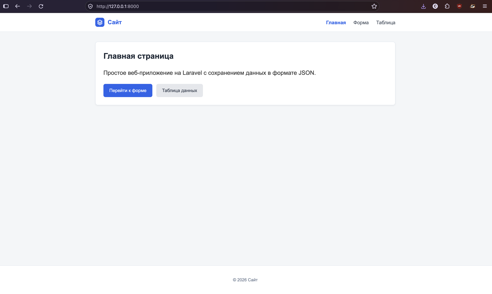
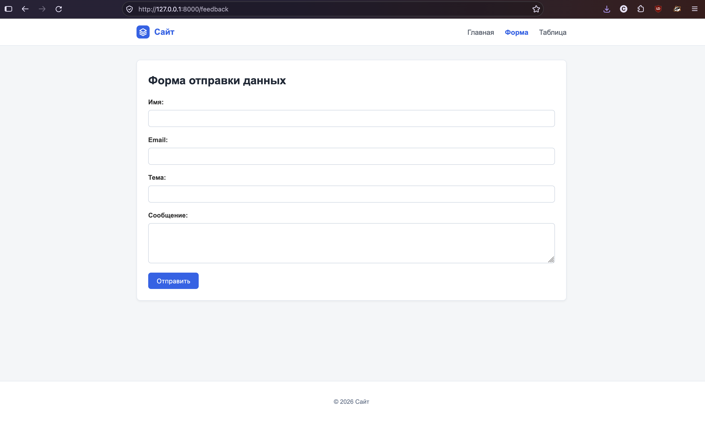
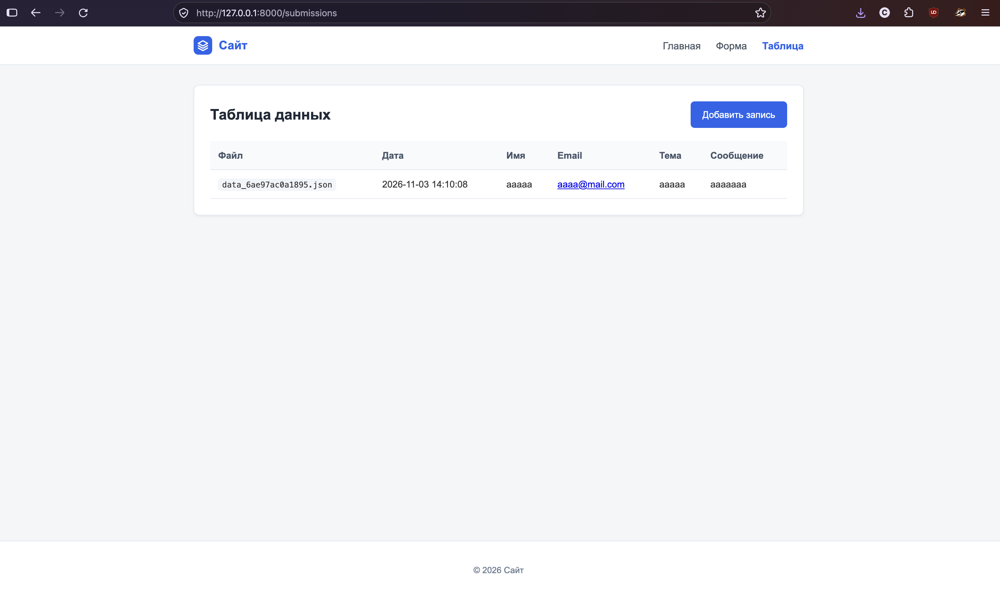

# Веб-приложение на Laravel

Базовое веб-приложение на фреймворке Laravel с сохранением данных формы в JSON-файлы.

## Запуск приложения

```bash
php artisan serve
```

Приложение доступно по адресу: `http://127.0.0.1:8000`

## Роуты

- `/` — главная страница
- `/feedback` — форма отправки данных (GET / POST)
- `/submissions` — таблица данных из JSON

## Скриншоты интерфейса

### Главная страница


### Форма отправки данных


### Таблица данных

